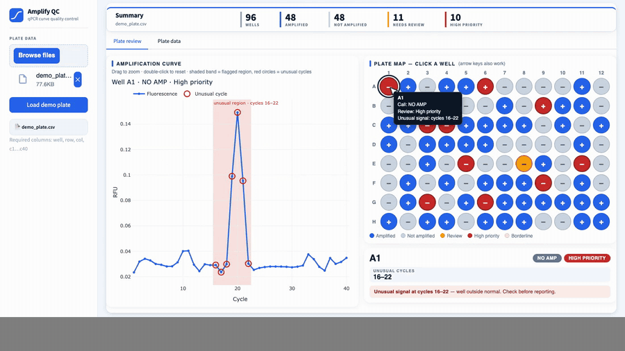

<div align="center">

# Amplify QC

**qPCR curve quality control: amplification calls, plus automatic flagging of unusual curves and cycles.**

<video src="https://github.com/umahkhan/amplify-qc/raw/main/Amplify_QC_Demo.mp4" poster="https://github.com/umahkhan/amplify-qc/raw/main/docs/demo_preview.gif" controls muted width="900">
  
</video>

</div>

---

Drop in a plate of raw qPCR cycle data (one row per well, 40 cycles of fluorescence) and Amplify QC:

1. **Calls every well AMP / NO AMP** with a RandomForest trained on curve-shape features, not a fixed RFU threshold.
2. **Flags unusual curves** with a separate autoencoder trained only on clean runs. Flagged wells are coloured on the plate map; the curve view shades the flagged region and circles the exact cycles that look unusual.
3. **Lists everything in plate order** on the Plate data tab, with a CSV export.

The two models are independent: a well can be a clear AMP and still carry an artifact worth a second look.

## Run it

```bash
pip install -r requirements.txt
streamlit run app.py
```

Click **Load demo plate** in the sidebar, or open `http://localhost:8501/?demo=1`. To use your own data, upload a CSV with columns `well`, `row`, `col`, `c1` … `c40`.

## How it works

| Piece | What it does |
|---|---|
| `qpcr_pipeline.py` | Constants, the AMP label rule, and the curve-shape features behind the RandomForest call. |
| `qpcr_v2.py` | The anomaly model and the pipeline the app talks to (see below). |
| `train_model.py` | Trains the pipeline once and writes `qpcr_model.pkl`. The app only does inference. |
| `app.py` | Streamlit app with a client-side plate map and curve viewer (instant clicks, arrow keys, zoom). |
| `Amplify_QC_Model_Walkthrough.ipynb` | Step-by-step notebook: channels, scaling, architecture, calibration, and per-cycle / per-window inference. |

**Anomaly model.** A small 1D conv autoencoder reads three channels per well (raw RFU, 1st and 2nd derivative), with kernel sizes of 7 and 5 to span the takeoff phase and replicate padding so the baseline (cycles 1-5) and plateau (cycles 36-40) edges don't trigger false anomalies. Residuals are scored per cycle and per sliding or phase window, each normalised against clean calibration wells of the same class (AMP or NO AMP). A well goes to review when its worst cycle or window exceeds 1.5x the calibrated limit.

**Materiality gate.** An amplifying well is only flagged if it departs from its own fitted S-curve by at least 5% of the curve height, so harmless baseline offsets don't clutter the review list.

## Retrain

```bash
python train_model.py            # ~2-3 min on CPU, writes qpcr_model.pkl
```

## Test plates

`test_plates/` has three 96-well plates, each built around a different family of anomaly patterns, plus a few harmless look-alike wells that should *not* be flagged. Bases are held-out clean wells the models never trained on; ground truth is in the `has_anomaly` and `anomaly_type` columns.

| Plate | Patterns |
|---|---|
| `plate1_spikes_dropouts_noise.csv` | single and double spikes, signal dropouts, early and late noise bursts |
| `plate2_drift_and_plateau.csv` | baseline drift and steps, creeping negatives, plateau droop, runaway and wobble, late weak rise |
| `plate3_takeoff_and_shape.csv` | biphasic curves, stalled takeoff and amplification, sudden drop, pre-takeoff bump, false takeoff, periodic wobble |

## Notes

- `train_normal.csv` is the clean training set. `demo_plate.csv` is built from training curves with artifacts injected into 14 wells, so results on it flatter the model; don't read them as validation.
- Thresholds and the 1.5x review limit were chosen on held-out clean wells. Validate on your own assay data before relying on the flags.
